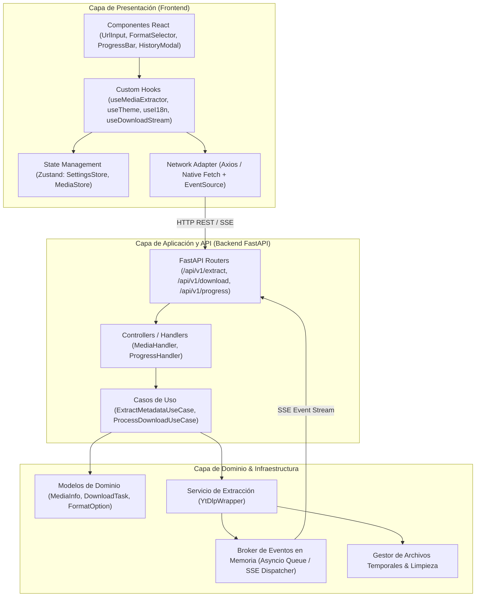
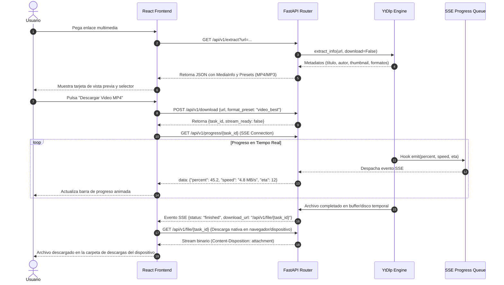

# 02. Arquitectura del Sistema - MediaStream Downloader

## 1. Visión General y Patrones de Arquitectura

**MediaStream Downloader** está construido bajo los principios de **Clean Architecture**, **Single Responsibility Principle (SRP)** y **Separación de Responsabilidades (SoC)**. 

El sistema divide el flujo en dos grandes componentes desacoplados:
1. **Frontend (SPA Mobile-First / Capacitor):** Interfaz reactiva en TypeScript con Vite y React 19, desacoplada de la lógica del sistema operativo mediante abstracciones y adaptadores de red.
2. **Backend (Media Engine API):** API REST asíncrona en Python con FastAPI y el motor de extracción `yt-dlp`, gobernada por casos de uso puros y adaptadores de infraestructura para transcodificación con `ffmpeg`.

---

## 2. Diagrama de Capas y Componentes Lógicos

---

## 3. Decisiones Tecnológicas Justificadas

### 3.1. Frontend: React 19 + TypeScript + Vite + Tailwind CSS
- **Por qué Vite + React:** Arranque y compilación instantáneos (HMR < 50ms), ecosistema maduro y consumo mínimo de memoria frente a soluciones pesadas.
- **Por qué Tailwind CSS:** Enfoque utility-first ideal para mobile-first responsive design, control total de temas (dark mode mediante clases `dark`), cero archivos CSS monolíticos redundantes.
- **Por qué Capacitor:** Permite ejecutar la misma base de código web directamente como aplicación nativa de Android, accediendo a APIs del dispositivo (almacenamiento de descargas, compartir, notificaciones locales) y habilitando la depuración y despliegue por **ADB**.

### 3.2. Backend: Python 3.11+ con FastAPI
- **Por qué FastAPI en Python:** `yt-dlp` es una biblioteca nativa de Python. El uso de Node.js o Go requeriría invocar `yt-dlp` como un subproceso CLI (`child_process.spawn`), lo cual introduce cuellos de botella de serialización, consumo excesivo de CPU y fragilidad al capturar logs de progreso. Con FastAPI en Python, `yt-dlp` se integra directamente a través de su API nativa de Python (`yt_dlp.YoutubeDL`) con *hooks* asíncronos en memoria.
- **Por qué Server-Sent Events (SSE):** En comparación con WebSockets, SSE es unidireccional (servidor a cliente), viaja sobre HTTP estándar (ideal para proxies inversos y Nginx sin configuraciones complejas de upgrades), reconecta automáticamente en cortes de red y consume sustancialmente menos recursos de servidor.

---

## 4. Flujo de Datos: Ciclo de Vida de una Descarga

---

## 5. Resiliencia, Limpieza y Gestión de Concurrencia
- **Mecanismo de Limpieza Automática (Garbage Collection):** Los archivos temporales generados por descargas o conversiones en el backend se etiquetan con un TTL (Time-To-Live de 30 minutos). Una tarea en segundo plano (`asyncio background task`) purga periódicamente archivos huérfanos para evitar el agotamiento de espacio en disco.
- **Manejo de Errores Desacoplado:** Excepciones de red, restricciones de edad, videos privados o enlaces inválidos son interceptados por un manejador de excepciones global en FastAPI que mapea cada error a un código HTTP semántico y un mensaje localizado en ES/EN para el usuario.
